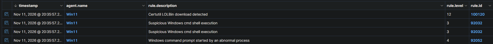
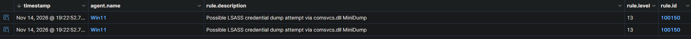
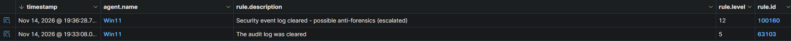
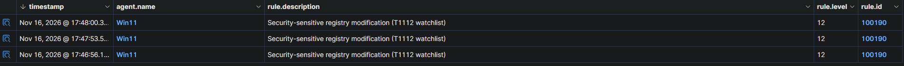
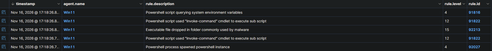

# Home SOC Lab — Detection Engineering with Wazuh

A hands-on home Security Operations Center (SOC) built to practice **detection engineering** and **purple teaming**: deploy a SIEM, collect meaningful endpoint telemetry, write custom detections mapped to MITRE ATT&CK®, and validate them by emulating real attacker techniques with Atomic Red Team — then find and close (or document) the gaps the tests expose.

> **Status:** Core project complete — 10 ATT&CK techniques emulated and analysed, 11 custom rules written. This is an ongoing learning project; I plan to keep extending it (more techniques, Linux endpoint monitoring, chained attacks), though the timing of future work is open.

---

## Overview

This project doesn't stop at "set it up." It uses the SIEM the way a real detection engineer does: **run attacks against it, see what the detections miss, understand *why*, and improve them — or decide a rule isn't the right fix.** Ten attacker techniques were emulated; each produced a distinct, honest outcome, and together they cover the breadth of what a junior SOC analyst / detection engineer encounters.

**Key outcomes**
- Stood up a Wazuh SIEM with an enrolled Windows 11 endpoint.
- Layered telemetry: Windows event logs → Sysmon → PowerShell Script Block Logging → a tuned Sysmon registry/file/process config.
- Wrote **11 custom detection rules** mapped to MITRE ATT&CK, including **severity tuning in both directions** and a **false-positive suppression**.
- Validated detections through adversary emulation, **closing real gaps** and **documenting telemetry blind spots** that couldn't be closed with a rule alone.
- Built the whole thing as a self-sufficient operator: SSH administration, a permanent static-IP fix, and systematic troubleshooting of a broken SIEM.

---

## Lab Architecture

| Component | Role |
|---|---|
| **Wazuh Manager** (Linux VM) | SIEM — collects telemetry, evaluates rules, raises alerts, hosts the dashboard |
| **Windows 11** (VM) | Monitored endpoint — Wazuh agent + Sysmon + PowerShell logging |
| **Atomic Red Team** | Adversary emulation framework, run on the endpoint to execute techniques |

```
                 +------------------------+
                 |   Wazuh Manager (SIEM) |
                 |   rules + dashboard    |
                 +-----------^------------+
                             | agent traffic (1514/1515)
                 +-----------+------------+
                 |   Windows 11 Endpoint  |
                 |   Wazuh Agent          |
                 |   + Sysmon (tuned cfg) |
                 |   + PowerShell logging |
                 |   + Atomic Red Team    |
                 +------------------------+
```

> Hosts run as isolated VMs. Internal IPs/hostnames are placeholders in this document — real IPs, agent keys, and other secrets are not committed to the repo.

---

## Telemetry Sources

Detection is only as good as the data collected, so telemetry was added in **layers** — each unlocking visibility the previous one lacked. This layering turned out to be a central theme (see *Key Lessons*).

| Source | Example Event IDs | What it reveals |
|---|---|---|
| Windows Security log | 4624 / 4625 / 1102 | Logons, failed logons, log clearing |
| **Sysmon — process** | 1 | Programs launched, full command lines, parent process |
| **Sysmon — registry** | 13 | Registry value writes (**selective** — curated keys only) |
| **Sysmon — file / process access** | 11 / 10 | File drops; one process opening a handle to another |
| **PowerShell Script Block Logging** | 4104 | The actual code PowerShell executes, including in-memory |

The Sysmon telemetry was upgraded mid-project from a minimal (process-only) config to the community **SwiftOnSecurity** config, which enabled registry/file/process-access events — a decisive moment (technique T1547.001).

---

## Adversary Emulation — Technique Matrix

Each technique was run with Atomic Red Team, then investigated with the loop: **run → did a detection fire? → why / why not? → improve, or decide no rule is warranted.** Outcomes are deliberately varied and honest.

| # | Technique (ATT&CK) | Test | Outcome |
|---|---|---|---|
| 1 | T1059.003 — Windows Command Shell | cmd execution | Caught by **built-in** rules (92032/92052). Lesson: separate **harness noise** from the real technique. |
| 2 | T1105 — Ingress Tool Transfer | certutil download | **Gap → wrote rule 100120.** PowerShell rules were blind to a `certutil` LOLBin. |
| 3 | T1033 — System Owner/User Discovery | whoami /all | **Deliberately no dedicated rule.** Recon is too common; detect via context/correlation, not single events. |
| 4 | T1547.001 — Registry Run Keys | Reg Key Run | **Built-in covered it (92302).** The real gap was **missing telemetry** — Sysmon registry logging was off → enabled it. Wrote 100130 (redundant, documented). |
| 5 | T1053.005 — Scheduled Task | schtasks local | **Gap → wrote rule 100140.** |
| 6 | T1003.001 — LSASS Memory | comsvcs.dll dump | **Prevented** by Windows LSASS protection (no dump produced). **Detected the *attempt*** → wrote rule 100150 (level 13). |
| 7 | T1070.001 — Clear Windows Event Logs | wevtutil cl Security | **Built-in covered it (63103)**, but under-weighted → **escalated** via rule 100160. Emulated **manually** (atomic missing from local copy). |
| 8 | T1218 — System Binary Proxy Execution | Wlrmdr LOLBin | **Telemetry blind spot** — attack succeeded (calc launched) but `wlrmdr` wasn't logged. Also surfaced a **false positive** (92213) → suppressed via rule 100170. Detection logic written (100180) pending telemetry. |
| 9 | T1112 — Modify Registry (×4 tests) | exec policy / Defender / RDP / UAC | **One watchlist rule (100190)** caught 3 techniques. **Prevention** (Defender tamper blocked) + **attempt-detection** (exec policy overridden by GP). |

*(T1087 Account Discovery was intentionally skipped — same lesson as T1033.)*

---

## Custom Detection Rules

All custom rules live in `/var/ossec/etc/rules/local_rules.xml` on the manager (IDs 100000+). The full file is in [`rules/local_rules.xml`](local_rules.xml). Summary:

| Rule | Level | What it detects | ATT&CK |
|---|---|---|---|
| 100100 | 12 | PowerShell download cradle on the **command line** | T1059.001 |
| 100110 | 12 | PowerShell download cradle **in memory** (`IEX`, via script-block logging) | T1059.001 |
| 100120 | 12 | `certutil` LOLBin download (`urlcache`/`verifyctl`) | T1105 |
| 100130 | 12 | Run-key persistence via `reg.exe` *(redundant with built-in 92302 — documented)* | T1547.001 |
| 100140 | 12 | Scheduled task created via `schtasks /create` | T1053.005 |
| 100150 | 13 | LSASS dump attempt (`comsvcs.dll` + `MiniDump`) | T1003.001 |
| 100180 | 12 | `wlrmdr` LOLBin *(logic ready; pending telemetry — documented blind spot)* | T1218 |
| 100190 | 12 | Security-sensitive registry modification — **watchlist** (exec policy / Defender / RDP / UAC) | T1112 |
| **100500** | **0** | **Tuning (down):** suppress routine admin logins from a known workstation | — |
| **100160** | **12** | **Tuning (up):** escalate "Security log cleared" (built-in 63103 is under-weighted) | T1070.001 |
| **100170** | **0** | **Tuning (FP):** suppress false positive on benign `__PSScriptPolicyTest` files | — |

### Two detections worth highlighting

**Command-line vs. in-memory (100100 / 100110).** The same download cradle is caught two ways: `100100` reads the process **command line**, `100110` reads the **executed script block** (Event 4104). This matters because an attacker running the cradle in memory via `IEX` leaves *nothing* on a command line — a blind spot that only script-block logging closes.

**Watchlist pattern (100190).** Rather than write one rule per registry key (T1112 has ~90 tests), a single rule matches a *watchlist* of security-sensitive indicators (`ExecutionPolicy Bypass`, `DisableAntiSpyware`, `fDenyTSConnections`, `LocalAccountTokenFilterPolicy`, …) — one maintainable rule that caught three different techniques in testing.

---

## Detections in Action

Custom rules firing against live emulated attacks:

**Certutil LOLBin download (rule 100120) — a gap the PowerShell rules missed:**



**LSASS credential-dump attempt (rule 100150, level 13) — detected the attempt even though Windows prevented the dump:**



**Security log cleared — severity tuned up from the built-in's level 5 to level 12 (rule 100160):**



**One watchlist rule (100190) catching multiple T1112 registry-modification techniques:**



---

## Detection Investigation Deep-Dive — The In-Memory Blind Spot

The single most instructive investigation in this project. It's a good example of *why* a detection fails even when the logic looks correct — and why the fix was a different telemetry source, not a better regex.

**Setup.** I wrote rule **100100** to catch PowerShell download cradles by matching download methods (`DownloadString`, `Invoke-WebRequest`, …) on the process **command line**. A direct test confirmed it worked — launching `powershell.exe -Command "(New-Object Net.WebClient).DownloadString('http://…')"` fired the alert.

**The failure.** I then ran the real adversary-emulation version of the technique (an `IEX` download cradle). The attack ran — and **rule 100100 never fired.** A search for `rule.id:100100` came back empty. My detection was blind to the exact thing it was written to catch.

**Diagnosis.** I pulled the process-creation event the test generated and looked at how the cradle was actually delivered:

```powershell
IEX (New-Object Net.WebClient).DownloadString('.../payload.ps1')
```

That was the whole answer. `IEX` (Invoke-Expression) executes code **in memory, inside an already-running PowerShell process** — so there's no new process, and nothing with the payload on its command line. Command-line telemetry only sees a payload when it rides in as a *new process's launch argument*. I confirmed the mechanism both ways: the `powershell.exe -Command "…"` form (which spawns a new process) was caught, while the in-memory `IEX` form evaded the rule entirely. **Same payload, different delivery, different detection surface** — and running code in memory is a deliberate, well-known attacker evasion.

**The fix — a different data source, not a better rule.** Command-line logging records *how PowerShell was launched*; **Script Block Logging (Event 4104)** records *what it actually executed*, in-memory code included. I enabled it, forwarded the `Microsoft-Windows-PowerShell/Operational` channel to Wazuh, and wrote rule **100110** to match the cradle in the executed **script-block text** instead of the command line. Re-running the attack, the detection fired.

**Takeaway.** One technique, two detection surfaces. Covering the command line alone leaves an in-memory blind spot; pairing it with execution (script-block) logging closes it. *Where* you detect is as important as *what* you match — the lesson that shaped the rest of the project.

---

## Diagnosing a Detection Gap — a Telemetry Blind Spot (T1218)

Not every gap is a missing rule; some are missing **telemetry**. This one is a gap I diagnosed but deliberately *couldn't* close with a rule — and understanding why is the point.

I ran `wlrmdr.exe` (T1218, System Binary Proxy Execution), a signed Windows binary abused to proxy execution. It **succeeded** — it launched Calculator, confirming the technique worked. But when I went to investigate, searching for the `wlrmdr` process returned nothing, and the only alerts in the dashboard were unrelated harness noise plus one false positive:



**How I diagnosed it.** The attack had clearly run, so I worked backwards from "no alert" through the detection pipeline: *rule → event → telemetry source.* The rule logic (match `image` ending in `wlrmdr.exe`) was sound, so I checked whether the underlying event even existed — and it didn't. The Sysmon config filters `wlrmdr` out of process-creation logging to cut noise, so no Event 1 was ever generated. **There was nothing for any rule to match.** The gap wasn't in the detection logic — it was one layer down, in what the endpoint was configured to collect.

**The honest outcome.** The fix here isn't a cleverer rule; it's **expanding telemetry collection** (removing `wlrmdr` from the Sysmon filter). I wrote the detection logic anyway — rule **100180** — and documented it as *pending telemetry*, so the moment the event is collected, the detection is already in place. Shipping a rule that can't fire yet, clearly labelled, is an honest way to track a known blind spot.

> The one high-severity alert visible above ("Executable file dropped in a folder commonly used by malware") is itself a **false positive** — it fired on a benign PowerShell `__PSScriptPolicyTest` file, not on the attack. I tuned it out separately with rule **100170**. So this single view captures two real detection-engineering problems at once: a telemetry blind spot *and* a noisy false positive.

---

## Key Lessons

1. **You can't detect what you don't collect — and "collecting" is a curated, never-complete decision.** This emerged three times: registry logging was *off* (T1547.001), process logging *filters* some binaries (T1218/wlrmdr), and registry logging is *selective* about which keys it watches (T1112). Detection has two levers — **telemetry** (what you collect) and **rules** (what you match) — and sometimes the fix is the first, not the second.
2. **Where you detect matters.** Command-line vs. in-memory execution are different surfaces; covering a technique from multiple angles beats one rule.
3. **Not every technique needs a new rule.** Some are already covered by built-ins (Run keys, log clearing) — *checking first* is a skill. Some (recon) are better left to context/correlation than a noisy single-event rule.
4. **Detection isn't the only defense.** Windows *prevented* two attacks outright (LSASS dump, Defender tamper) — but you still want to alert on the *attempt*. And "the test exited 0" ≠ "the attack succeeded" — always verify the actual outcome.
5. **Tuning goes both ways.** Suppress routine noise (admin logins, benign `__PSScriptPolicyTest` files) *and* escalate under-weighted critical signals (log clearing). A noisy or mis-weighted detection is as much a problem as a missing one.

---

## Lab Engineering & Troubleshooting

Beyond detection, this project involved standing up, operating, and repairing the environment — the operational skills behind the detections:

- **Remote administration over SSH** — managed the Linux SIEM from a Windows workstation (proper remote admin instead of the VM console).
- **Permanent static-IP fix** — diagnosed that the server was booting IPv6-only (no IPv4 DHCP lease), traced it through `systemd-networkd`, and rewrote `20-eth0.network` to a static config — ending a recurring connectivity problem for good.
- **Telemetry engineering** — upgraded Sysmon to the SwiftOnSecurity config (unlocking registry/file/process-access events) and enabled PowerShell Script Block Logging.
- **Workflow optimization** — Guest Additions for host↔VM clipboard; a PowerShell profile to auto-load the Atomic Red Team module every session.
- **SIEM troubleshooting** — recovered a non-starting Wazuh manager multiple times by reading `ossec.log`, identifying XML ruleset errors (nested groups, a leaked shell heredoc marker, unwrapped rules), and fixing them; diagnosed a `modulesd` stale-PID issue after reboots.
- **Snapshot discipline** — learned that a restore discards all later changes, and adopted "snapshot the fully-configured state" as the baseline.

---

## Skills Demonstrated

SIEM deployment & administration (Wazuh) · agent enrollment · endpoint telemetry engineering (Sysmon, PowerShell Script Block Logging) · custom detection-rule authoring · false-positive and severity tuning · MITRE ATT&CK mapping · adversary emulation (Atomic Red Team) · purple-team workflow · log analysis & triage · Linux system administration & networking (systemd-networkd, SSH) · systematic troubleshooting.

---

## MITRE ATT&CK Coverage

| Technique | Name | Rule(s) / Outcome |
|---|---|---|
| T1059.001 | Command & Scripting Interpreter: PowerShell | 100100, 100110 |
| T1059.003 | Windows Command Shell | built-in (92032/92052) |
| T1105 | Ingress Tool Transfer | 100120 |
| T1033 | System Owner/User Discovery | context/correlation (no dedicated rule, by design) |
| T1547.001 | Boot/Logon Autostart: Registry Run Keys | built-in 92302; 100130; telemetry enabled |
| T1053.005 | Scheduled Task | 100140 |
| T1003.001 | OS Credential Dumping: LSASS Memory | 100150 (attempt); prevented by OS |
| T1070.001 | Indicator Removal: Clear Windows Event Logs | built-in 63103; escalated via 100160 |
| T1218 | System Binary Proxy Execution | 100180 (pending telemetry); documented blind spot |
| T1112 | Modify Registry | 100190 (watchlist) |

---

## Future Work

This project is ongoing — I intend to keep building on it (timing open):
- **Linux endpoint monitoring** (auditd / Sysmon for Linux) — a *monitored* Linux host, not just the SIEM server.
- **Closing the documented telemetry blind spots** — expanding Sysmon registry/process coverage so techniques like wlrmdr and un-watched registry keys become visible.
- **Correlation rules** — e.g., alerting on a *burst* of discovery commands rather than single events.
- **Chained attacks from a separate attacker host (Kali)** — full kill-chain emulation (recon → payload → C2 → post-exploitation) for end-to-end detection practice.

---

## A Note on Approach

This project was built as a hands-on learning exercise, using an AI assistant as a tutor and pair-debugger. I used it to learn *by doing* — not to have the work done for me. I made (and caught) real mistakes along the way: XML typos that stopped the manager from starting, a snapshot restore that wiped my setup, rules that didn't fire because of rule precedence, false-positive and telemetry-coverage issues I spotted and worked through myself, and a recurring network problem I traced to its root cause. At each step I focused on understanding *why* something worked, not just *what* to type — and I can explain every rule, finding, and design decision in this repo. The troubleshooting was part of the learning, not a detour around it.

---

*Built as a learning project to develop practical detection-engineering skills. All testing was performed against isolated lab VMs that I own.*
